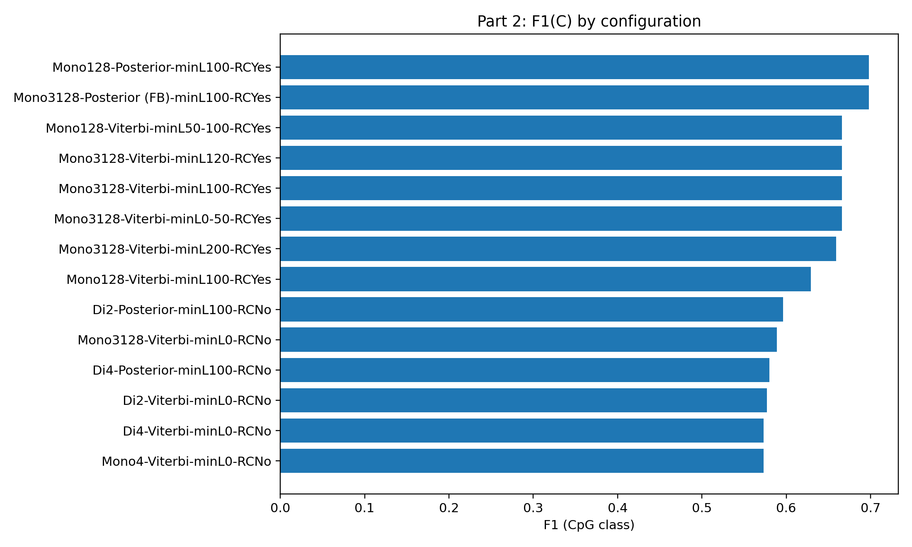
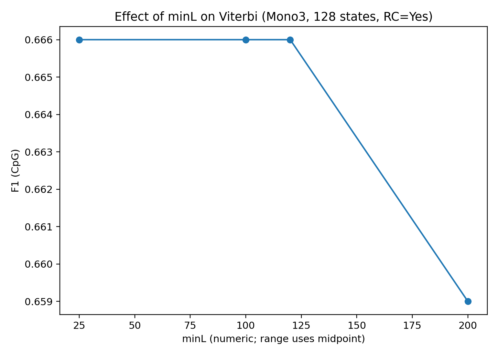

# Existing results and edition boundaries

Two figures are copied unchanged from the coursework archive's `part 2/graphs` directory. No experiments were rerun or new scores computed for this release.

## Configuration comparison

The labels compare model encodings, Viterbi/posterior decoding, reverse-complement augmentation, and minimum-length settings. Read these values as historical coursework observations. The exact plotting driver, source measurement table, and complete run manifest were not retained with the selected modular source, so this chart is not a verified score for the default classifier in this package.

## Minimum-length filtering

This records the filtering comparison that accompanied the same archived figure set. The figure itself is preserved rather than redrawn or relabeled.

## What this release packages

The code is the modular edition: explicit state schemes, encoders, a supervised trainer, decoders, and `CPGPipeline`. The top-level classifier selects the 128-state Viterbi configuration. The older report in the private archive describes another experiment edition and is deliberately not presented as the report for this source snapshot.

The public-facing claims are therefore about implemented methods and inspectable experiment artifacts. A fresh external-data benchmark, a reconstructed experiment driver, and reconciliation of the older report are outside this first packaging pass.
